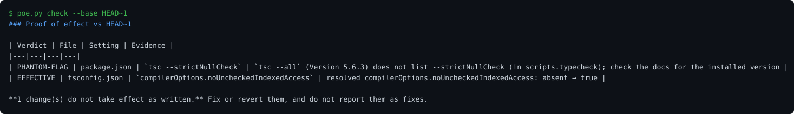

# proof-of-effect

[](https://github.com/awesome-proof-of-effect/proof-of-effect/actions/workflows/tests.yml)

An agent skill that proves a config change actually changes what the tool does, before anyone calls it a fix.

Coding agents often "fix" things by adding a setting the tool quietly ignores. The key ends up in the wrong place or is misspelled. The option belongs to another version. The flag does not exist. The env var lacks the prefix the bundler needs. Or the action input is one letter off. CI stays green and the diff looks plausible, so nobody notices that nothing changed.

`proof-of-effect` asks the tool itself. It resolves the config with the base version of each changed file and with the new one, then compares the two. It also checks GitHub Action inputs against the action's metadata, env vars against the code that reads them, and CLI flags against the installed tool's `--help`.

## Demo

A commit that claims to tighten type-checking: one tsconfig key really takes effect, one CLI flag is a typo of a real one and is silently ignored. The checker tells them apart in one run.



This picture is generated from real output by [`make_demo.py`](skills/proof-of-effect/scripts/make_demo.py) and a test keeps it in sync, so it is never hand-drawn or out of date.

## Example

An agent changed five files to "turn on strict checks and speed up CI":

```text
| Verdict      | File                     | Setting                                       | Evidence |
|--------------|--------------------------|-----------------------------------------------|----------|
| UNKNOWN-KEY  | .github/workflows/ci.yml | jobs.test.steps[0].with.cache-dependency-pat  | actions/setup-node/action.yml@v4 has no input `cache-dependency-pat` (inputs: ..., cache-dependency-path, ...); GitHub only warns "Unexpected input" and runs the step without it |
| NO-OP        | tsconfig.json            | strict                                        | `tsc --showConfig -p tsconfig.json` shows no change for it; the resolved changes (compilerOptions.noUncheckedIndexedAccess) all come from this file's other edits |
| NOT-READ     | .env.example             | API_URL                                       | only read in browser code (src/main.ts), but Vite exposes only VITE_-prefixed variables on import.meta.env |
| PHANTOM-FLAG | package.json             | tsc --strictNullCheck                         | `tsc --all` (Version 5.6.3) does not list --strictNullCheck (in scripts.typecheck) |
| EFFECTIVE    | tsconfig.json            | compilerOptions.noUncheckedIndexedAccess      | resolved compilerOptions.noUncheckedIndexedAccess: absent → true |
| EXISTS       | .github/workflows/ci.yml | jobs.test.steps[0].with.cache                 | declared input of actions/setup-node/action.yml@v4 |

4 change(s) do not take effect as written.
```

All four problems passed CI.

## Findings: the top 925 GitHub repos

We ran the GitHub Actions check across the workflows of the 925 most-starred public repositories:

- 102,293 `with:` inputs checked.
- 113 inputs that the called action does not declare, in 46 repos (5%). GitHub only logs an "Unexpected input" warning for these, and the step still passes.
  - 20 are typos of a real input, for example `cached` instead of `cache`, or `issue-lock-inactive-days` instead of `issue-inactive-days`.
  - 23 exist only in a newer version of the action than the one the workflow pins.
- 20 findings were re-checked one at a time against the exact `action.yml` at the pinned ref, and all 20 held up.

The method, numbers and scanner are in [research/actions-inputs-2026-10](research/actions-inputs-2026-10/).

## Install

One command copies the skill into every coding agent it detects on your machine (Claude Code, Codex, Kiro, Cursor, Windsurf):

```bash
python3 skills/proof-of-effect/scripts/install.py
```

It writes the skill to each agent's skills folder (for example `~/.claude/skills/proof-of-effect`) and skips any agent it does not find. Useful flags:

```bash
python3 skills/proof-of-effect/scripts/install.py --list        # show which agents it would target
python3 skills/proof-of-effect/scripts/install.py --agent kiro  # just one agent
python3 skills/proof-of-effect/scripts/install.py --dest DIR    # any other SKILL.md skills folder
python3 skills/proof-of-effect/scripts/install.py --dry-run     # show what it would do, copy nothing
python3 skills/proof-of-effect/scripts/install.py --force       # overwrite an existing copy
```

It is plain Python, needs nothing beyond the standard library, and never overwrites an existing copy unless you pass `--force`. You can still install by hand: copy `skills/proof-of-effect` into your agent's skills folder yourself. Either way, the agent loads the skill when it edits configuration.

The checker also works on its own:

```bash
python3 skills/proof-of-effect/scripts/poe.py check                     # working tree vs HEAD
python3 skills/proof-of-effect/scripts/poe.py check --base origin/main  # a whole branch
python3 skills/proof-of-effect/scripts/poe.py check --all               # audit existing Action inputs, env vars and script flags
python3 skills/proof-of-effect/scripts/poe.py probe --files app.yaml -- python -m app --print-config
```

It needs Python 3.9+ and git and has no other dependencies. PyYAML enables the workflow checks. Exit code 1 means a change does not take effect, so it can also run in CI.

## GitHub Action

Run it on every pull request without an agent. It compares each PR against its base branch and writes the verdict table to the run's job summary; the check fails when a change does not take effect.

```yaml
# .github/workflows/proof-of-effect.yml
name: proof-of-effect
on: pull_request
permissions:
  contents: read
jobs:
  proof-of-effect:
    runs-on: ubuntu-latest
    steps:
      - uses: awesome-proof-of-effect/proof-of-effect@v1
```

The action checks out the PR and its base with full history, installs PyYAML, and runs the same checker. Inputs (all optional):

| Input | Default | What it does |
|---|---|---|
| `base` | the PR's base branch | Commit or ref to compare against. |
| `only` | all checkers | Comma-separated subset, e.g. `tsconfig,gha`. |
| `offline` | `false` | Do not fetch GitHub Action metadata over the network. |
| `strict` | `false` | Also fail on UNCLEAR and UNVERIFIABLE findings. |
| `fail-on-problems` | `true` | Set `false` to report in the summary without failing the check. |

The table appears under the run's **Summary** tab whether the check passes or fails.

## What it checks

- **Resolved config, before and after:** tsc, ESLint, Jest, Ruff, pytest, and Docker Compose (experimental).
- **GitHub Actions:** `with:` inputs against `action.yml` or a reusable workflow's inputs.
- **Env vars:** whether anything reads the variable, and the Vite, Next.js and CRA browser-prefix rules.
- **CLI flags:** in package scripts, workflow `run:` lines, Makefiles and shell scripts, against the installed tool's `--help`.
- **Anything else:** `probe` runs a command of your choice with the base and the changed files and compares its output.

The details and the known gaps are in [skills/proof-of-effect/references/checks.md](skills/proof-of-effect/references/checks.md).

## Safety

For the before run, the changed file is swapped back to its base version for a moment, then restored byte for byte, including mode and mtime. Backups and a recovery manifest are written to `.git/poe/` first. `poe.py restore` undoes an interrupted run, and the next run refuses to start until the files are restored. `--no-swap` skips every step that touches files. The only network call fetches public `action.yml` files, and `--offline` turns it off.

## Development

```bash
python -m pytest tests          # unit tests; tool tests skip when a tool is missing
POE_TEST_TOOLPATH=/path/to/node_modules/.bin:/path/to/venv/bin python -m pytest tests
```

The integration tests run real tsc 5.6.3, ESLint 9.13.0, Jest 29.7.0, Ruff 0.7.1 and pytest 8.3.3.

## License

MIT
